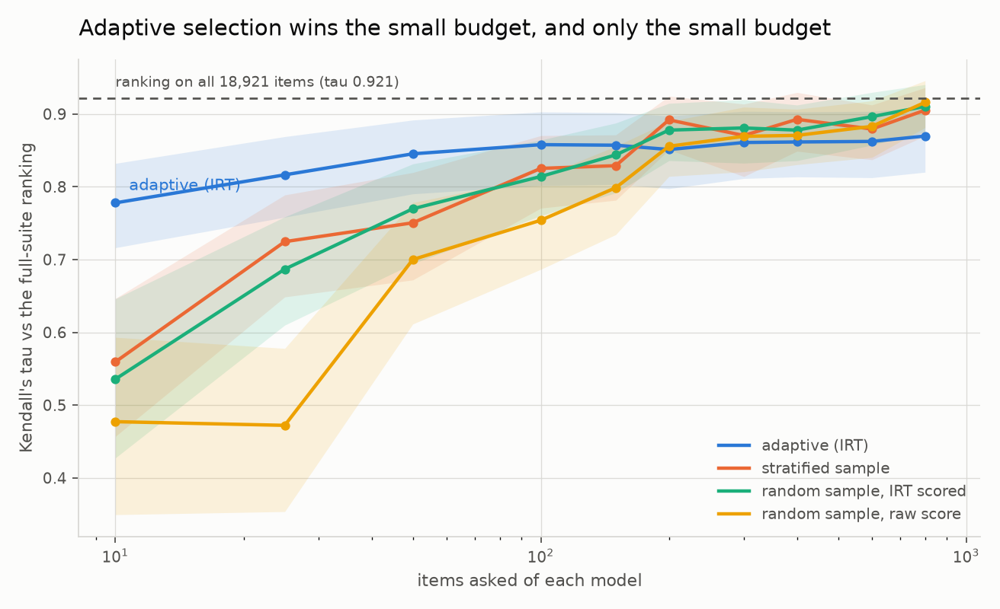
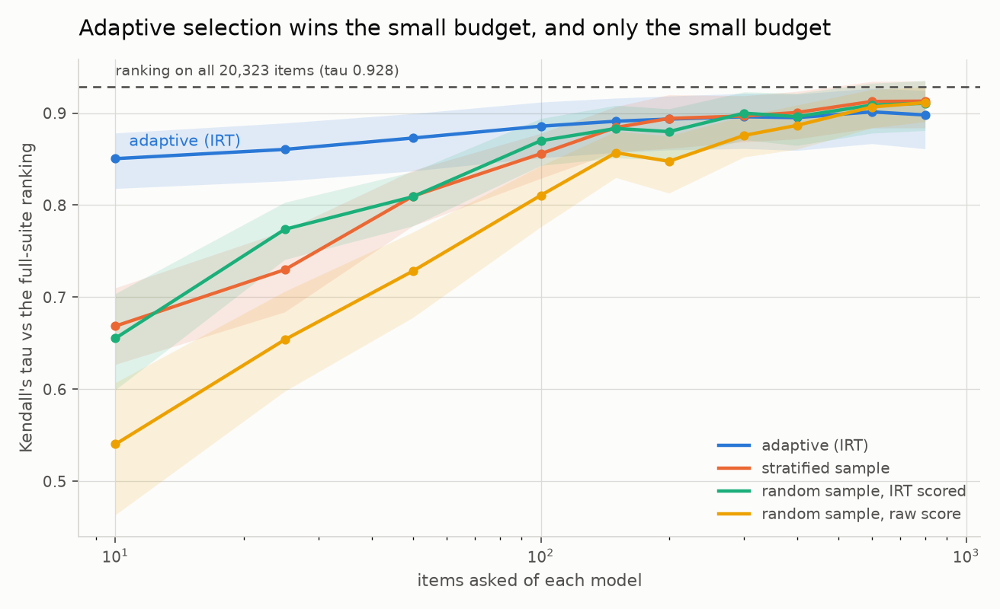

# Model Selection at a Tenth of the Cost

Answers "which AI model should we use, and did the new version get worse?" with statistical
confidence, using a fraction of the evaluation calls a full benchmark needs. For a team
re-evaluating models every month, that is a day instead of a week and tens of dollars instead
of thousands, and it names the benchmark questions that were never measuring anything.

**[Run the adaptive test yourself at adaptive.peterparker.ca](https://adaptive.peterparker.ca)**:
pick two of the sixteen models this project paid to run, and watch the test ask one question at a time until the two are separated, beside the same two models being asked questions at random. It is the real procedure on the real recorded answers, it runs in the browser, and most pairs are settled inside a hundred questions for a few cents. There is a button that runs all hundred and twenty pairs at once, which is the same claim without having to take one run's word for it.

Item response theory, the psychometrics behind every standardised test, fitted to a matrix of
150 language models by 20,365 benchmark items built from the public HELM per-item releases.
Calibrate the items once, then test each new model adaptively on the items that discriminate at
its level, and stop when the interval is tight enough to decide.

Then, because a result measured on one panel is a result about that panel, the whole method is
run again on a second bank built from a different source, a different harness and a different
kind of model: 400 open-weight submissions by 20,323 items from the Open LLM Leaderboard. It
replicates, and the two banks share 998 questions, which turns "item parameters may not
transfer" into a number. [Both are below.](#does-it-replicate-a-second-bank-from-a-different-source)

## Result

<!-- mselect:results:start -->
| Measure | Result |
|---|---|
| **Calls saved at the screening budget**: items an ordinary random sample needs to rank as well as 10 adaptive items | 127 items, **12.7 times** the adaptive budget (tau 0.778) |
| Kendall's tau against the full 18,921-item ranking, 10 adaptive items (0.05% of the suite) | **0.778** (95% CI 0.716 to 0.832); best baseline 0.559 (0.457 to 0.647) |
| Kendall's tau against the full 18,921-item ranking, 50 adaptive items (0.3% of the suite) | **0.845** (95% CI 0.790 to 0.892); best baseline 0.750 (0.672 to 0.819) |
| Kendall's tau against the full 18,921-item ranking, 200 adaptive items (1.1% of the suite) | **0.851** (95% CI 0.797 to 0.897); best baseline 0.892 (0.851 to 0.925) |
| Kendall's tau against the full 18,921-item ranking, 800 adaptive items (4.2% of the suite) | **0.870** (95% CI 0.820 to 0.909); best baseline 0.905 (0.870 to 0.936) |
| Ceiling on any ability-based ranking: the fit on all 18,921 items, against the suite average | tau 0.921 (ability and suite average are not the same construct) |
| Panel the ranking claim is measured on | 74 models x 18,921 items, 99.1% complete |
| Items needed to detect a 3-point accuracy drop at 80% power (mid-panel ability) | 118 items per model |
| Items needed to detect a 1-point drop at 80% power (mid-panel ability) | 3,559 items per model |
| Items whose discrimination is below 0.3, out of 20,365 | 4,262 (20.9%) |
| Items whose fitted slope is negative (the mis-keyed signature) | 1,757 (8.6%) |
| Items carrying no measurable information at mid-panel ability | 4,221 (20.7%) |
| Local dependence: item pairs with Q3 above 0.2 | 8% to 31% of pairs, depending on the benchmark |
| Dimensionality: correlation between per-benchmark abilities | 0.42 to 0.96 across benchmark pairs |
| Reliability: the same model answering the same item twice | 93.6% agreement (n = 6,000 repeated cells) |
| Differential item functioning, open weights vs API only | 128 items flagged (0.9%) |
| Test-retest: the same 500 items asked twice at temperature 0, a day apart | hosted models agree **0.936** (0.912 to 0.956) to 0.984 (0.972 to 0.994); the two on a laptop agree 0.998 and 1.000 |
| How much a benchmark score moves with nothing changed | **up to 2.0 points**, median 0.2, and symmetric (75 flips to right against 88 to wrong, p = 0.35), so it is a random walk rather than drift. A drop smaller than that is noise |
| Option order: the same 300 questions asked 4 times with the answer in a different position | every one of 12 models is worse when the answer is at A than at C or D (11/12); items that flip on order alone, net of the model's own instability, run from **0.9%** (0.0% to 3.5%) on `openai-frontier` to **42.9%** (37.6% to 48.6%) on `local-small-a` |
| What this project's answer-only prompt costs against letting the model reason briefly, over 300 items and 3 templates | **nothing for 10 of 12 models** (interval spans zero); the template explains at most **0.3%** of the variance in correctness. The exceptions are `anthropic-haiku` at 5.0% (2.0% to 8.4%), `local-mid-a` at 4.4% (0.7% to 7.8%) |
| Does this bank rank models it was never fitted on? 16 current models, 2,754 items each, parameters read and not refitted | Kendall's tau **0.883** (0.730 to 1.000) |
| Adaptive items needed to rank those 16 models as well as all 2,754 do | **150 items** (5.4% of the suite), tau 0.933 (0.820 to 1.000) |
| Cost per ranking decision, in dollars | **US$1.01** against US$14.67 to ask every item, 6.9% |

Bank `v1` (`4a9871d69f3360d8`): 150 models x 20,365 items, 1,648,626 recorded responses from the public HELM per-item releases. Fitted with marginal maximum a posteriori by Bock-Aitkin EM, 61-point normal quadrature. Regenerate with `mselect report --version v1`.
<!-- mselect:results:end -->



More figures: [what the bank can measure, by ability](docs/figures/information.png), [item
parameters and the items that carry no information](docs/figures/item-parameters.png), [local
dependence by benchmark](docs/figures/local-dependence.png).

## The honest limitation

**Benchmark items are not independent, and that is measured here rather than assumed away.**
Between 8 and 31 percent of item pairs, depending on the benchmark, have a Q3 residual
correlation above 0.2: they share passages, templates, subjects and formats. Every standard
error from a fixed-length benchmark is therefore optimistic, including some of the ones in the
table above. The benchmarks also do not measure one single ability: per-benchmark abilities
correlate between 0.42 and 0.96, so the composite is a summary, not a measurement of one thing.
[docs/diagnostics.md](docs/diagnostics.md) reports both in full. The consequence is stated in
the unit that matters: on this bank a hundred MATH items carry about six items' worth of
independent evidence, a hundred MMLU items about forty-seven, and `mselect.dependence()` hands
that correction to anything importing the bank. **The second bank says the correction is not a
property of the benchmark alone**: MATH is the worst offender in both, but a hundred of its items
are worth about six on bank v1 and about eleven on bank v2. Take the correction from the bank you
are using, not from the benchmark's name.

**And the efficiency claim has a ceiling, which the table above shows rather than hides.**
Adaptive selection wins decisively where it matters for a screening decision: ten items rank the
panel as well as 127 randomly chosen ones, a 12.7 times saving. Above roughly 200 items it stops
winning and a plain random sample overtakes it. The reason is not a broken estimator, it is a
construct gap: the adaptive test converges on the bank's ability scale (Kendall's tau 0.92
against the ability fitted on all 18,921 items), while the thing a leaderboard reports is the
suite average, and those two rankings agree only at tau 0.92 even with every item in hand. If
you want the benchmark's own average, sample randomly and score it directly. If you want to know
which model is better, ask ten well-chosen questions.

**The sixteen models, named.** Everything else in this repository addresses the panel by alias,
because a vendor renaming a model must not break the code. That is the wrong unit for a reader,
so the mapping is published here, taken from the identifier each vendor returned on the call
rather than from the configuration that asked for it.

<!-- mselect:panel:start -->
| Alias | The model that answered | Where it ran | Accuracy | The full suite cost |
|---|---|---|---:|---|
| `google-frontier` | `gemini-3.8-flash` | hosted, through the gateway | 93.4% | US$1.48, 1.9 hours |
| `anthropic-opus` | `claude-opus-5` | hosted, through the gateway | 92.5% | US$4.07, as a batch, so untimed |
| `anthropic-sonnet` | `claude-sonnet-5` | hosted, through the gateway | 90.5% | US$1.20, as a batch, so untimed |
| `openai-frontier` | `gpt-5.6-sol` | hosted, through the gateway | 89.6% | US$3.92, 1.2 hours |
| `google-mid` | `gemini-3.5-flash-lite` | hosted, through the gateway | 89.4% | US$1.14, 0.7 hours |
| `anthropic-haiku-b` | `claude-haiku-5-5` | hosted, through the gateway | 89.2% | US$0.17, as a batch, so untimed |
| `openai-mid-b` | `gpt-6-luna` | hosted, through the gateway | 88.6% | US$0.18, 1.4 hours |
| `together-open-d` | `Qwen/Qwen3.8-Flash` | hosted, through the gateway | 86.2% | US$0.15, 1.5 hours |
| `together-open-c` | `deepseek-ai/DeepSeek-V4.1-Flash-1017` | hosted, through the gateway | 85.9% | US$0.19, 0.2 hours |
| `anthropic-haiku` | `claude-haiku-4-5-20251001` | hosted, through the gateway | 85.5% | US$0.56, as a batch, so untimed |
| `together-open-b` | `openai/gpt-oss-120b` | hosted, through the gateway | 84.6% | US$0.20, 0.5 hours |
| `together-open-a` | `meta-llama/Llama-3.3-70B-Instruct-Turbo` | hosted, through the gateway | 83.6% | US$0.92, 1.6 hours |
| `openai-mid` | `gpt-5.4-mini-2026-03-17` | hosted, through the gateway | 80.3% | US$0.49, 0.5 hours |
| `local-mid-a` | `qwen2.5:7b` | a laptop, through ollama | 65.0% | US$0.00, and 8.5 hours of laptop |
| `local-small-a` | `llama3.2:3b` | a laptop, through ollama | 55.0% | US$0.00, and 4.9 hours of laptop |
| `local-small-b` | `qwen2.5:3b` | a laptop, through ollama | 54.7% | US$0.00, and 3.3 hours of laptop |
<!-- mselect:panel:end -->

These are the identifiers as the vendors returned them, dated snapshot and hosting prefix
included, because this table is a record of which model answered.
[adaptive.peterparker.ca](https://adaptive.peterparker.ca) drops both when it shows a name: the
date on `claude-haiku-4-5-20251001` is evidence in a record and noise in a comparison, and
`meta-llama/` in front of `Llama-3.3` is how the model is addressed on the host that serves it
rather than part of its name.

The last column is two currencies on purpose. Three of these models cost nothing in dollars and
hours of a laptop that could do nothing else while they ran, and a table that prints US$0.00 and
stops tells a team with its own hardware that evaluation is free. It is not: it is paid in a
machine rather than an invoice, and a short test saves that just as surely. The four Anthropic
models have no time at all, because this project sends them through the Message Batches endpoint
at half price and a call inside a batch has no latency worth reporting.

**Four models joined on 2026-11-17, and running them found a defect in two of the September rows.** `claude-haiku-5-5`, `gpt-6-luna`, `DeepSeek-V4.1-Flash-1017` and `Qwen3.8-Flash` were asked the same suite through the same answer-only prompt for US$0.86 together. Two of them think before answering unless told not to, so their requests carry a setting that switches it off, and checking that the setting arrived showed that from 2026-09-12 `mselect run` had never sent any per-model setting, while the request hash recorded them as sent. Two September models had one: `gemini-3.8-flash`, meant to have its thinking budget set to zero, and `gpt-oss-120b`, meant to have reasoning set low. Both were asked the whole suite again, every template and option rotation, with the settings actually sent, for US$3.31, and the September records are kept beside the new ones in `out/v1/superseded-2026-11-17/`. Neither moved much: on the answer-only template `gemini-3.8-flash` went from 92.8% (91.8% to 93.7%) of the questions it answered to 92.3% (91.3% to 93.2%), and `gpt-oss-120b` from 84.6% (83.2% to 85.8%) to 83.1% (81.7% to 84.4%) on 60% fewer output tokens. One limit stays: Gemini 3.8 Flash cannot switch thinking off entirely, only down to a minimum, so its row is a model that thought a little.

**The own-run panel reproduces that ceiling on models the bank never saw, which is the version of the result that counts.** Sixteen current models from four vendors, 2,754 items each, asked through this repository's own prompts and parser; the item parameters were read from the bank and nothing was refitted. They rank at Kendall's tau 0.883 (0.730 to 1.000), and 150 adaptively chosen items reach 0.933 (0.820 to 1.000) for US$1.01 against US$14.67 to ask everything; 100 items reach 0.867 (0.725 to 0.965) for US$0.67. The ceiling is lower here than on the public bank and the reason is the same construct gap, now measured twice: ability and suite average are different quantities, and no number of items closes the distance between them. Adaptive selection is ahead of a plain random sample at every checkpoint except 750 items, and every interval overlaps, because sixteen models is a small sample. These figures moved when four models joined in November: on the twelve run in September, over 2,816 items, the same rows read tau 0.879, and 100 items reaching it for US$0.73 against US$15.97. The common frame shrank to 2,754 items because an item any one model left unanswered leaves it for all of them.

**At the top of the panel the suite runs out of questions, and the estimator says so by saturating.** The ability grid this estimator carries runs from -4.5 to +4.5. Asked to place the strongest models, the adaptive test lands `anthropic-sonnet` at +4.38 where scoring the whole suite puts it at +3.72, and `openai-frontier` at +4.47 against +3.20, so their intervals are narrow against a boundary rather than narrow on evidence and the pairwise rule never separates them. The cause is countable: only 82 of the 2,754 suite items are both harder than +3 and discriminating enough to measure with, and the models above +3 get 82 to 93 percent of the items the selector picks right, where a well-targeted item should be close to a coin flip. The bias is in the same direction all the way down the panel, at +0.3 for a 7B on a laptop and +1.3 for a frontier model, which is what a bank fitted on 150 models evaluated between 2023 and 2025 does when it is pointed at a 2026 shortlist: those models beat its expectations on exactly the sharp items maximum-information selection prefers. Rankings survive it, because a monotone bias does not reorder anything, but at the top it compresses seven of the sixteen models into the last half point of the scale, which is one reason the own-run curve plateaus. **Treat an estimate within half a point of the grid edge as unmeasured**, and for a frontier-against-frontier comparison bring harder items. [adaptive.peterparker.ca](https://adaptive.peterparker.ca) draws that edge and names it, because a curve flattened against a wall otherwise reads as precision.

Three more limits worth stating before the method is used for anything:

- Every item is binary-scored, so this measures capability, knowledge and instruction
  following, not writing quality. Open-ended generation is out of scope by design.
- The calibration panel is 150 models evaluated by HELM between 2023 and 2025. Item parameters
  are on that panel's scale, and the second bank measures what that costs: over the 998 questions
  the two banks share, difficulty correlates 0.71 for the items that discriminate in both and
  not at all for the rest. Filter on discrimination before importing difficulty.
- The bank holds 19,883 distinct questions across 19,919 administrable items: **36 questions
  appear twice**, 35 of them because MMLU-Pro was assembled partly out of MMLU and the same
  question arrives under two ids. They are reported rather than deduplicated, because a bank that
  silently drops items is one whose count nobody can check, and they are the exact end of the
  local dependence scale that [docs/diagnostics.md](docs/diagnostics.md) measures with Q3.
- The own-run validation is sixteen models, not a hundred. They span 0.55 to 0.93 accuracy across four vendors and a laptop, but a bootstrap over sixteen models is wide: every interval in that part of the table overlaps every other. What it settles is
  that the parameters transfer at all. What it cannot settle is a ranking of methods.
- `items_needed` is optimistic for large effects. Against the simulation it is well calibrated
  for small gaps and over-promises for big ones (88 percent predicted against 42 percent
  observed for models 5 to 10 points apart at ten items), because it assumes items are locally
  independent and they are not. Treat it as a floor. [PLAN.md](PLAN.md) section 13.6.

## Decision models on the same ruler

A decision model returns a probability for each option and no text. A multiple-choice question is already that shape: the question is the state and its options are the choices. So seventeen decision models were asked the bank's own multiple-choice items, in the order and with the answer key the text models had, scored right or wrong from the option given the highest probability, and placed on the same ability scale by the same fixed item parameters, with nothing refitted. That is the point of a calibrated bank: a new kind of model needs no new benchmark, it needs the same ruler. The free-response items (MATH and GSM8K, about 7% of the suite) have no options and were not asked. Fourteen of the decision models are hosted and were reached through OpenRouter for US$0.41 in all, 2,783 questions each; three ran on this laptop. Every probability is kept in the record, so whether a 0.8 is right eight times in ten can be measured later from the same files.

<!-- mselect:decision:start -->
Scored on the 2,454 multiple-choice items that all 17 decision models and all 16 text models answered.

| Model | Kind | Where it ran | Accuracy (95% interval) | Ability (95% interval) | The full suite cost |
|---|---|---|---:|---:|---|
| `gemini-3.8-flash` | text | hosted | 93.7% (92.7% to 94.6%) | +4.47 (+4.34 to +4.60) | see above |
| `gpt-5.6-sol` | text | hosted | 92.3% (91.2% to 93.3%) | +4.45 (+4.28 to +4.62) | see above |
| `claude-opus-5` | text | hosted | 92.7% (91.7% to 93.7%) | +4.42 (+4.20 to +4.63) | see above |
| `gpt-6-luna` | text | hosted | 91.3% (90.1% to 92.4%) | +4.41 (+4.18 to +4.63) | see above |
| `typesafe/jev-1.14-20261014` | decision | hosted, through OpenRouter | 90.1% (88.9% to 91.3%) | +4.28 (+3.97 to +4.60) | US$0.055 |
| `gemini-3.5-flash-lite` | text | hosted | 90.1% (88.9% to 91.3%) | +4.12 (+3.78 to +4.47) | see above |
| `claude-sonnet-5` | text | hosted | 91.1% (89.9% to 92.2%) | +4.05 (+3.70 to +4.40) | see above |
| `typesafe/jev-1.13-20260917` | decision | hosted, through OpenRouter | 90.4% (89.2% to 91.5%) | +3.95 (+3.60 to +4.29) | US$0.055 |
| `Qwen/Qwen3.8-Flash` | text | hosted | 88.9% (87.6% to 90.1%) | +3.90 (+3.56 to +4.24) | see above |
| `google/gemini-decision-1-20261111` | decision | hosted, through OpenRouter | 89.1% (87.8% to 90.3%) | +3.51 (+3.20 to +3.82) | US$0.065 |
| `claude-haiku-5-5` | text | hosted | 89.2% (88.0% to 90.4%) | +3.49 (+3.18 to +3.80) | see above |
| `deepseek-ai/DeepSeek-V4.1-Flash-1017` | text | hosted | 87.1% (85.7% to 88.4%) | +3.36 (+3.06 to +3.66) | see above |
| `perplexity/pplx-decider-v1.3-20261112` | decision | hosted, through OpenRouter | 87.8% (86.5% to 89.1%) | +3.33 (+3.04 to +3.63) | US$0.000 |
| `liquid/d1.2-ultra-20261116` | decision | hosted, through OpenRouter | 88.0% (86.6% to 89.2%) | +3.30 (+3.01 to +3.60) | US$0.020 |
| `perplexity/pplx-decider-v1.2-20261016` | decision | hosted, through OpenRouter | 87.9% (86.5% to 89.1%) | +3.27 (+2.98 to +3.57) | US$0.013 |
| `liquid/d1.2-20261116` | decision | hosted, through OpenRouter | 87.5% (86.1% to 88.7%) | +3.12 (+2.84 to +3.40) | US$0.010 |
| `claude-haiku-4-5-20251001` | text | hosted | 87.6% (86.2% to 88.8%) | +3.10 (+2.82 to +3.38) | see above |
| `nace-ai/drex-max-20261016` | decision | hosted, through OpenRouter | 87.4% (86.1% to 88.7%) | +3.05 (+2.78 to +3.33) | US$0.038 |
| `microsoft/microsoft-decision-1.1-20261117` | decision | hosted, through OpenRouter | 85.9% (84.5% to 87.3%) | +2.78 (+2.52 to +3.04) | US$0.020 |
| `nace-ai/drex-v2.0-20261009` | decision | hosted, through OpenRouter | 84.3% (82.8% to 85.7%) | +2.57 (+2.32 to +2.82) | US$0.027 |
| `meta-llama/Llama-3.3-70B-Instruct-Turbo` | text | hosted | 83.5% (82.0% to 84.9%) | +2.44 (+2.20 to +2.68) | see above |
| `openai/gpt-oss-120b` | text | hosted | 84.9% (83.4% to 86.2%) | +2.34 (+2.11 to +2.58) | see above |
| `gpt-5.4-mini-2026-03-17` | text | hosted | 82.8% (81.3% to 84.3%) | +2.32 (+2.08 to +2.55) | see above |
| `openai/gpt-6-luna-decisions-20261006` | decision | hosted, through OpenRouter | 82.9% (81.3% to 84.3%) | +2.17 (+1.94 to +2.40) | US$0.070 |
| `perplexity/pplx-decider-flash-v1.2-20261016` | decision | hosted, through OpenRouter | 78.6% (77.0% to 80.2%) | +1.36 (+1.18 to +1.55) | US$0.006 |
| `togethercomputer/tev1-4b-experimental-20260923` | decision | hosted, through OpenRouter | 71.3% (69.4% to 73.0%) | +0.28 (+0.14 to +0.42) | US$0.029 |
| `jaredpalmer/kev-4b` | decision | a laptop | 71.2% (69.4% to 72.9%) | +0.26 (+0.12 to +0.41) | US$0.00, and 8.6 hours of laptop |
| `qwen2.5:7b` | text | a laptop | 69.0% (67.1% to 70.8%) | +0.08 (-0.08 to +0.23) | see above |
| `qwen2.5:3b` | text | a laptop | 58.6% (56.7% to 60.6%) | -0.88 (-0.99 to -0.77) | see above |
| `baseten/joey-1-20261029` | decision | hosted, through OpenRouter | 57.9% (55.9% to 59.8%) | -1.08 (-1.20 to -0.96) | US$0.007 |
| `llama3.2:3b` | text | a laptop | 57.4% (55.4% to 59.3%) | -1.09 (-1.21 to -0.96) | see above |
| `strands-decider-2B-hobson-v21` | decision | a laptop | 52.6% (50.6% to 54.5%) | -1.46 (-1.59 to -1.34) | US$0.00, and 4.0 hours of laptop |
| `laya-rl-agent` | decision | a laptop | 31.4% (29.6% to 33.3%) | -3.00 (-3.06 to -2.94) | US$0.00, and 0.9 hours of laptop |
<!-- mselect:decision:end -->

What the table says:

- **The best decision models sit among the text models, for a few cents a suite.** `jev-1.14` lands between `gpt-6-luna` and `gemini-3.5-flash-lite` on the ability scale, and the full suite cost it US$0.055 against US$0.15 to US$4.07 for the hosted text models. Most of the hosted decision models sit in the band the mid-priced text models occupy.
- **"Decision model" is not one level of quality.** The seventeen run from +4.28 to -3.00, the whole width of the text panel and further, so the category says how a model answers, not how well.
- **The bank ranks them about as well as it ranks text models.** Over every item, ability and observed accuracy agree at Kendall's tau 0.971 (0.888 to 1.000, n = 17). The short adaptive test does worse here than on the text panel: at 10 items it reaches 0.397 (-0.031 to 0.748) where a test stratified by benchmark reaches 0.750 (0.480 to 0.936), and it overtakes only from about 200 items, 0.897 (0.728 to 1.000). This panel is spread so wide that a coarse sample from every benchmark already separates most of it, and seventeen models make every one of these intervals wide.
- **Four questions are unanswered on purpose.** OpenAI refused four questions sent through `gpt-6-luna-decisions`, twice each, and they are recorded as unanswered rather than wrong, which is why the frame is the 2,454 items every model answered.
- **One model may have seen the test.** `kev-4b` is the one model here whose training may have included MMLU-Pro. Its MMLU-Pro accuracy is 55% (47% to 63%, n = 150) against 47% (39% to 55%, n = 144) for `tev1-4b`, which matches it on everything else; the intervals overlap, so the run neither shows contamination nor rules it out.

## What this says, if you do not do statistics for a living

A benchmark score is a count of correct answers, and a count cannot tell these five kinds of
question apart. It treats them as equal evidence about which model to buy.

| What a question does | What it tells you about which model to buy | What a percentage does with it |
|---|---|---|
| Every model gets it right | Nothing. It separates nobody | Counts it, at full weight |
| Every model gets it wrong | Nothing. It separates nobody | Counts it, at full weight |
| Its stored answer key is wrong | Worse than nothing: it penalises the models that were right | Counts it, at full weight |
| It leaked into training data | Measures memory, not capability | Counts it, at full weight |
| It cleanly separates stronger models from weaker ones | This is the entire signal you are paying for | Counts it, at full weight |

Nobody knows which questions are in which row, because benchmark results are published as one
aggregate and the per-question detail is thrown away. Standardised testing solved this decades
ago: measure each question first, then give each candidate the questions that tell you the most
about them. That is what this repository does to a language model benchmark, and four things fall
out of it that a leaderboard cannot say.

**A fifth of the questions are not measuring anything.** 20.9% of this bank discriminates below
0.3, which means the answer barely depends on how good the model is, and 8.6% runs backwards:
stronger models get them wrong more often, which is the signature of a wrong stored answer. That
is one item in five that costs money on every run and separates nobody, and the list of them is
published.

**Ten well-chosen questions do the work of 127 random ones.** That is the screening budget, where
the saving is, and it is measured against two baselines rather than asserted. It does not hold
everywhere: above about two hundred questions a plain random sample catches up, for a reason
stated in the limitation above rather than cropped out of the chart.

**A benchmark score moves on its own.** The same models, the same questions, asked twice a day
apart with randomness turned down as far as the vendors allow: up to two accuracy points move
with nothing changed at all, and they move in both directions equally. Every "the new version
dropped two points" claim has to clear that floor first, and almost nobody publishes what their
floor is.

**Some of a leaderboard is formatting.** Ask the same multiple-choice question with the right
answer in a different position and, on the weakest model here, 43% of answers change. On the
strongest, under 1%. Both numbers sit in the same published table at the same apparent precision.

If you are hiring for evaluation work, the part worth looking at is not the headline. It is that
the ceiling on the method is published beside it, the caveats are measured rather than waved at,
and every number in this file is regenerated by one command from the artefacts in the repository.

## Using it to choose a model

Everything above is a decision procedure rather than a leaderboard, so here is the shape of it
on a real shortlist and what each step costs.

**Ask what the decision needs, before spending anything.**

```python
import mselect
mselect.items_needed(3, 0.8, ability=0.0)   # 118 items per model, to catch a three point drop
mselect.items_needed(1, 0.8, ability=0.0)   # 3,559 items per model, for a one point drop
```

This is the step usually skipped, and it is where an evaluation budget goes. If the candidates
are about a point apart, no affordable test will separate them and the decision belongs to
price, latency or context window instead. Learning that before the first call is itself a
result. Treat the number as a floor, for the reason in the limitation above.

**Screen the shortlist at ten items each.** Ten adaptively chosen items rank a panel about as
well as 127 randomly chosen ones on bank v1 (tau 0.778, 95% CI 0.716 to 0.832) and 143 on bank
v2 (tau 0.851, 0.818 to 0.878). Five candidates is fifty calls, and the bottom of a shortlist
usually falls away at once.

**Resolve the survivors pairwise.** The last two are close by construction, so change the
stopping rule from "tight enough" to "decided", and keep asking until the intervals come apart.

```python
decision = mselect.separated(ability_a, ability_b)
decision.describe("candidate-a", "candidate-b")
# the shape of the answer, for example:
# candidate-a ahead after 34 items
# (candidate-a 0.71 [0.42, 0.99], candidate-b 0.18 [-0.11, 0.46])
```

**Take "not separated" as an answer too.** Overlapping intervals are reported as not separated
at this budget, never as the same. That outcome says the two models are indistinguishable for
what you were willing to spend, which is a decision result: stop paying for evaluations and
choose on cost.

The release-gate question, "did the new version get worse?", is the same procedure with the old
and new versions as the pair, plus one asymmetry. Failing to separate is not reassurance unless
the budget was large enough to find the drop you care about, which is what `items_needed` is
for. Not separated after 118 items means something. After twelve it means nothing.

Two things the bank hands a consumer that a benchmark score does not: `mselect.dependence()`
turns a count of items into the number of independent items they are worth, and the
[broken-item report](docs/items-that-measure-nothing.md) names the ones to drop before trusting
any difficulty at all.

### What runs today, and what does not

The loop above runs end to end against the 550 models already calibrated in the two banks, on
models held out of the fit, which is where every number in the tables comes from. Pointing it at
a model of your own choosing needs the one piece this repository does not have: something that
makes a vendor call. `mselect/runner/` holds what to ask, the option rotations, the answer
parsers and the scoring rules, tested against adversarial replies, and takes a `Caller` it is
handed; the caller goes through the portfolio gateway, project 04. That seam is deliberate, so
that none of the scoring logic needs a network, a key or a dollar to test. It is an adapter
rather than a rebuild, and it is the same gap the Status section names.

## Where the useless items are

One item in five in bank v1 discriminates below 0.3 and one in twelve has a negative slope,
which are two rows of the table above and the least interesting way to say it. The share is not
spread evenly, and which benchmark a reader uses decides whether any of this is about them.

<!-- mselect:benchmarks:start -->
| Benchmark | Items | Discrimination below 0.3 | Negative slope |
|---|---:|---:|---:|
| Massive Multitask Language Understanding | 13,937 | 18.6% | 7.2% |
| LegalBench | 2,047 | 53.0% | 27.2% |
| GSM8K (grade-school word problems) | 1,000 | 4.9% | 0.9% |
| MedQA (US medical licensing questions) | 1,000 | 20.1% | 7.1% |
| MMLU-Pro | 998 | 14.8% | 5.0% |
| OpenBookQA | 500 | 4.4% | 0.6% |
| GPQA (graduate-level Q&A) | 446 | 32.3% | 12.1% |
| MATH (competition mathematics) | 437 | 5.9% | 0.7% |
<!-- mselect:benchmarks:end -->

GSM8K, MATH and OpenBookQA are in good health by this measure. Over half of LegalBench's items,
as administered in HELM Lite, do not separate strong models from weak ones, and more than a
quarter run backwards, meaning stronger models get them wrong more often. A negative slope has
four possible causes, not equally interesting: a mis-keyed answer, an ambiguous question where
the better model sees the ambiguity, a grader marking a correct answer wrong, and genuine
inverse scaling. Telling them apart needs the item text and a human, which is why nothing here
is named as mis-keyed. But it takes one fit to produce the list, and if you own a benchmark it
is where to look first.

[**Your benchmark is measuring fewer things than you think**](docs/writeup.md) is the write-up
of what fell out of this: the five findings in full, the empirical curves of the worst items,
and what to do about each on Monday, including the two audiences this README does not otherwise
address. If you own a benchmark, fit a 2PL to the per-item results you already have and read the
bottom of the discrimination list; the dead items are free to find and cost you money every run.
If you publish an evaluation number, publish a Q3 and a dimensionality check beside it, because
both are cheap and both change how the interval should be read.

## Does it replicate? A second bank, from a different source

Everything above is one item bank: 150 models, mostly frontier APIs, scored by HELM. A result
measured once on one panel is a result about that panel. So the whole method was run again on a
bank with almost nothing in common with the first.

Bank `v2` is **400 open-weight submissions to the Open LLM Leaderboard by 20,323 items, 99.8
percent complete** - where bank v1 is 54 percent observed and its headline has to be measured on
a nearly-complete block peeled out of it. The panel is drawn ten from each of forty equal-width
bands of the leaderboard average, so it spans the range from near-chance to the top of the
open-weight field instead of clustering where the submissions do, and it is capped at eight
models per hub organisation because forty merges of one base model are close to one model
repeated. The selection is mechanical and seeded, so the panel is whatever those two rules
returned: model names are as their authors published them on the hub, and none were dropped or
kept on the strength of what they are called. It covers BIG-Bench Hard, MMLU-Pro, MuSR, MATH at level 5 and GPQA, and where bank v1
reads the model's stated final answer after chain-of-thought, this one takes the
highest-likelihood option.

<!-- mselect:results:v2:start -->
| Measure | Result |
|---|---|
| **Calls saved at the screening budget**: items an ordinary random sample needs to rank as well as 10 adaptive items | 143 items, **14.3 times** the adaptive budget (tau 0.851) |
| Kendall's tau against the full 20,323-item ranking, 10 adaptive items (0.05% of the suite) | **0.851** (95% CI 0.818 to 0.878); best baseline 0.669 (0.627 to 0.710) |
| Kendall's tau against the full 20,323-item ranking, 50 adaptive items (0.2% of the suite) | **0.873** (95% CI 0.837 to 0.900); best baseline 0.810 (0.777 to 0.838) |
| Kendall's tau against the full 20,323-item ranking, 200 adaptive items (1.0% of the suite) | **0.893** (95% CI 0.860 to 0.919); best baseline 0.894 (0.862 to 0.920) |
| Kendall's tau against the full 20,323-item ranking, 800 adaptive items (3.9% of the suite) | **0.898** (95% CI 0.861 to 0.925); best baseline 0.913 (0.884 to 0.935) |
| Ceiling on any ability-based ranking: the fit on all 20,323 items, against the suite average | tau 0.928 (ability and suite average are not the same construct) |
| Panel the ranking claim is measured on | 150 models held out of 400 x 20,323 items, 99.8% complete |
| Items needed to detect a 3-point accuracy drop at 80% power (mid-panel ability) | 90 items per model |
| Items needed to detect a 1-point drop at 80% power (mid-panel ability) | 2,100 items per model |
| Items whose discrimination is below 0.3, out of 20,323 | 8,070 (39.7%) |
| Items whose fitted slope is negative (the mis-keyed signature) | 4,004 (19.7%) |
| Items carrying no measurable information at mid-panel ability | 7,102 (34.9%) |
| Local dependence: item pairs with Q3 above 0.2 | 3% to 15% of pairs, depending on the benchmark |
| Dimensionality: correlation between per-benchmark abilities | 0.26 to 0.98 across benchmark pairs |
| Reliability: the same model answering the same item twice | no repeated administrations in this bank, so no figure |
| Differential item functioning, merged models vs models trained directly, at matched ability | 1,449 items flagged (7.3%) |
| Differential item functioning, open weights vs API only | not measurable on this panel |
| Do these item parameters mean anything on bank `v1`? All 998 shared items | difficulty correlates -0.04 (-0.10 to 0.02) |
| The same, over the 532 shared items that discriminate above 0.3 in both banks | difficulty correlates **0.71** (0.67 to 0.75) |
| Test-retest reliability | _pending their own arms (PLAN.md section 4.3)_ |
| Position bias | _pending their own arms (PLAN.md section 4.3)_ |
| Prompt-framing effects | _pending their own arms (PLAN.md section 4.3)_ |
| Cost per ranking decision, in dollars | _pending the own-run panel (run `mselect run` then `mselect validate`)_ |

Bank `v2` (`b66652e06b8acf5d`): 400 models x 20,323 items, 8,114,706 recorded responses from the Open LLM Leaderboard v2 per-item details. Fitted with marginal maximum a posteriori by Bock-Aitkin EM, 61-point normal quadrature. Regenerate with `mselect report --version v2`.
<!-- mselect:results:v2:end -->

Where the useless items are in this bank, on the same aggregation as v1 above:

<!-- mselect:benchmarks:v2:start -->
| Benchmark | Items | Discrimination below 0.3 | Negative slope |
|---|---:|---:|---:|
| MMLU-Pro | 12,034 | 39.1% | 19.8% |
| BIG-Bench Hard | 5,761 | 39.8% | 19.2% |
| MATH level 5 (the hardest competition problems) | 1,324 | 15.0% | 1.0% |
| MuSR (multistep soft reasoning) | 756 | 70.8% | 40.9% |
| GPQA (graduate-level Q&A) | 448 | 76.6% | 44.4% |
<!-- mselect:benchmarks:v2:end -->

GPQA is 32.3% dead on bank v1 and 76.6% here, which is the bank-dependence point again rather
than a contradiction. Discrimination is measured against a panel, and a question almost none of
this panel can answer separates nobody: most of these 400 open-weight submissions sit near
chance on GPQA, so the item has no one left to tell apart. Read a share in this table as a
statement about the benchmark and the panel together, never about the benchmark alone.



**The shape of the result replicates and the ceiling replicates almost exactly.** Ten adaptive
items rank this panel as well as 143 randomly chosen ones, against 127 on bank v1. Adaptive
selection is decisively ahead up to about a hundred items and the baselines pass it above two
hundred, as before. And the construct gap that causes it is the same size in both banks: ability
fitted on every item agrees with the suite average at tau 0.928 here and 0.921 there, so the
ceiling on any ability-based ranking is a property of the two measurements, not of one dataset.

More on this bank: [its diagnostics in full](docs/diagnostics-v2.md), [its broken
items](docs/items-that-measure-nothing-v2.md), [what it can measure by
ability](docs/figures/information-v2.png), [its item
parameters](docs/figures/item-parameters-v2.png), [its local
dependence](docs/figures/local-dependence-v2.png).

### The same 998 questions, calibrated twice

Every MMLU-Pro item HELM sampled is among the 12,032 the leaderboard runs. So the same questions
are calibrated on panels with no models in common, through harnesses that score them differently,
and "a bank calibrated on a different panel is a different bank" stops being a caveat and becomes
a measurement. The pairing is on MMLU-Pro's own question id, which both sources keep, and it was
checked against the question text itself before the excerpts were removed from the bank: all 998
matched.

| Items compared | Difficulty correlation | One bank's hardest tenth, recovered by the other |
|---|---|---|
| All 998 shared items | **-0.04** (-0.10 to 0.02) | 14.1% (7.6 to 21.7) |
| The 532 that discriminate above 0.3 in both banks | **+0.71** (0.67 to 0.75) | 49.1% (34.0 to 60.4) |

The first row reads as "item parameters do not transfer at all", and it is arithmetic rather
than psychometrics: difficulty is `-d/a`, so an item whose slope is indistinguishable from zero
has a difficulty that is a division and not a measurement, and the unfiltered correlation is
dominated by those. The second row is what a consumer gets who drops the items that measure
nothing first.

Which makes [the broken-item report](docs/items-that-measure-nothing.md) a prerequisite for using
an item bank rather than a curiosity, and gives project 03 a rule rather than a warning: **filter
on discrimination before importing difficulty.** Even then the two banks agree about half the
time on which items are in the hardest tenth, so item parameters are portable enough to rank
items and not portable enough to use as constants.

`mselect crossbank` regenerates the table.

## What it does

- **Calibrates the bank.** A 2PL and a 3PL fit by marginal maximum likelihood over the whole
  matrix, with standard errors on every parameter, item fit statistics, and the answer-key and
  contamination checks.
- **Finds the items that measure nothing.** One item in five discriminates below 0.3, and one
  in twelve has a negative slope, meaning stronger models get it wrong more often.
  [docs/items-that-measure-nothing.md](docs/items-that-measure-nothing.md) lists them with
  evidence.
- **Tests adaptively.** Maximum Fisher information selection with content balancing across
  benchmarks, expected a posteriori ability estimation, and two stopping rules: a target
  precision, and "these two models are now separated".
- **Says how many items you need.** `items_needed(effect, power, ability)` turns "detect a
  three-point regression" into a number of items, derived from the bank's information function
  and checked against the simulation.
- **Checks whether any of it transfers.** Two banks, 998 shared questions, one number for
  whether difficulty calibrated on one panel means anything on another. It does, for the items
  that measure something, and not at all for the rest.
- **Hands the result to the next project.** `import mselect` gives the power function, the frozen
  banks, the adaptive estimator, the reliability figure and the local-dependence correction, with
  the caveats attached rather than left in a document. [CHANGELOG.md](CHANGELOG.md) says what
  v0.2.0 contains and, as plainly, what it does not.

Three architecture diagrams, the system, the adaptive loop and how the numbers are produced, are in
[docs/architecture.md](docs/architecture.md).

## Reproduce it

```bash
uv sync
uv run mselect bank fetch     # ~320 MB of public HELM per-item results, cached forever
uv run mselect bank build     # freeze the versioned, content-hashed item bank
uv run mselect fit            # 2PL item parameters, about a minute
uv run mselect diagnose       # fit statistics, Q3, dimensionality, DIF
uv run mselect simulate       # leave-one-model-out adaptive simulation vs the baselines
uv run mselect report         # regenerate the table above, the documents and the figures
```

And the second bank, which needs a free Hugging Face read token in `HF_TOKEN` because the
leaderboard's per-item datasets are gated. A token is the whole gate: no access request is filed
and nothing is written to the account it belongs to.

```bash
uv run mselect bank panel                        # choose 400 models and prove they are readable
uv run mselect bank fetch-ollm                   # about 1 GB, one column of each file at a time
uv run mselect bank build --source ollm --version v2
uv run mselect fit --version v2                  # then diagnose, simulate --evaluate 150, report
uv run mselect crossbank                         # do the two banks agree about the same items?
```

Nothing in either list costs money. The HELM public buckets need no account at all, and every
byte fetched from either source is cached with the date it was fetched, the URL it came from and
the size of the file it was taken from.

## Status

The build is nearly finished.

**Measured from public per-item data**: everything in both tables above, on two independent
banks, at no cost to anyone.

**Measured by running current models here**: the transfer result and the dollar cost per
ranking decision. The panel is sixteen models across Anthropic, OpenAI, Google, an open-weights host and three models on a laptop. Twelve were administered the committed 3,000-item suite between 2026-09-12 and 2026-09-17 for US$18.25 through the portfolio gateway, which enforces the spend caps and records every call; four more joined on 2026-11-17 and 2026-11-18, and two of the September twelve were asked again with the settings a defect had dropped, for US$4.17 together. Seventeen decision models were asked the multiple-choice items on the same days for US$0.41. `mselect validate` reads the records
back and costs nothing to repeat.

**Not measured yet**: nothing in the own-run half. All three measurement experiments of
[PLAN.md](PLAN.md) section 4.3 are run, and the last caveat on them was paid off on 2026-09-18
with a second administration of the `letter_only` and `brief_reasoning` templates, 7,200 calls
for US$3.38, so the noise each template is charged is now measured under that template rather
than borrowed from the answer-only one. What remains open is stated where it belongs: the item
term in finding 8 is still not noise-free, and the 36 repeated questions in
[docs/diagnostics.md](docs/diagnostics.md) are a floor rather than a count, because duplicates
are matched on exact text.

**Published as a page as well as a table.** [adaptive.peterparker.ca](https://adaptive.peterparker.ca)
runs the adaptive test in the browser against those sixteen models' recorded answers, and it is
built from these artefacts by `mselect demo build` rather than written by hand.
[docs/deploy.md](docs/deploy.md).

A vendor call is possible from this repository now, and it is gated. `mselect run` and
`mselect smoke` are the only commands that can spend, both refuse to send anything without an
explicit `--yes`, and both print what they would ask first. Every other command reads what is
already recorded.

Both push the ledger to the portfolio dashboard at
[gateway.peterparker.ca](https://gateway.peterparker.ca) when they finish, so its record of this
project's calls is as of the last run rather than the last time the gateway's own repository
pushed. The push happens only when the run wrote to `out/own-run-ledger.sqlite`, runs on the way
out of a failed run too (a run stopped by a spend cap has still spent up to it), and uses a
current `boundary` as a tool beside this project's pin, as project 04's `docs/central.md`
describes. The source is always `model-selection-tenth-cost:out/own-run-ledger.sqlite`, the name
the first push used, so each push adds to that source rather than starting another. The ingest
key is read from `BOUNDARY_INGEST_KEY`, or from that line of `.env`, never from a flag, and is
never printed. A push that fails prints a warning and leaves the run's exit code alone;
`mselect push-ledger` repeats it on its own, and a push that succeeds ends "the central ledger
holds N of this source's N".

## How it is built

`mselect` is a typed Python package: `data/` fetches and freezes the bank, `irt/` fits and
diagnoses it, `cat/` runs the adaptive test and the simulation, `power.py` is the interface
project 03 imports, `report/` writes everything in this README, and `demo/` writes the data
behind the page. `ruff` and `mypy --strict` are
clean and the tests fail meaningfully: parameter recovery on simulated matrices, adaptive
estimator convergence, planted local dependence and planted differential item functioning both
detected, and answer parsers against adversarial fixtures.

The same checks run before the commit, not after the push. `.githooks/pre-commit` runs
`ruff format --check`, `ruff check` and `mypy --strict`, about five seconds together, and
`.githooks/pre-push` runs the test suite. Turn them on once per clone:

```bash
git config core.hooksPath .githooks
```

- [PLAN.md](PLAN.md): the plan this was built against, and the places reality changed it.
- [docs/data-sources.md](docs/data-sources.md): what was verified about the public sources, and
  what turned out to be gated.
- [docs/items-that-measure-nothing.md](docs/items-that-measure-nothing.md): the broken-item report.
- [docs/diagnostics.md](docs/diagnostics.md): local dependence, dimensionality and DIF in full.
- [docs/rejected.md](docs/rejected.md): two approaches tried and rejected, with the evidence.
  One was this project's own headline assumption. The other would have corrupted an item bank
  silently rather than loudly, which is the more useful failure.
- [docs/writeup.md](docs/writeup.md): the practitioner write-up, "your benchmark is measuring
  fewer things than you think".
- [docs/deploy.md](docs/deploy.md): how the page at
  [adaptive.peterparker.ca](https://adaptive.peterparker.ca) is built and hosted. `demo/` is
  five static files and a folder of JSON written by `mselect demo build`, so nothing on it can
  say anything this repository did not measure.

## Licence, and what is redistributed

The code is [MIT licensed](LICENSE). **No benchmark text is in this repository**: not a question,
not an answer, not an excerpt. The bank stores a content hash of each item, the source's own
instance id and the benchmark it came from, which is enough to reproduce every number here and
enough to look any item up at its source, without carrying a line of anyone else's benchmark.
What is redistributed is measurements, which model answered which item correctly, from two
openly published evaluation projects. [docs/data-sources.md](docs/data-sources.md) names the
sources, what was taken and the terms.

## Part of a portfolio

This project supplies the statistical core of the AI Release Gate, which uses its item bank and
its power function to say how many eval items a regression test actually needs.

## How this was built

The design, the methods, the evaluation and the judgement calls are mine. The one I would
defend hardest is the second bank. A result measured on one panel of models is a result about
that panel, so I ran the whole method again on questions from a different source, a different
harness and a different kind of model, and used the 998 questions the two banks share to put a
number on whether question difficulty carries over.

I used AI coding assistants (Claude Code) for implementation and drafting, the way a senior
engineer uses them in 2026. Every number in the results table is reproducible from this
repository with one command, and that reproducibility is the evidence that matters.
