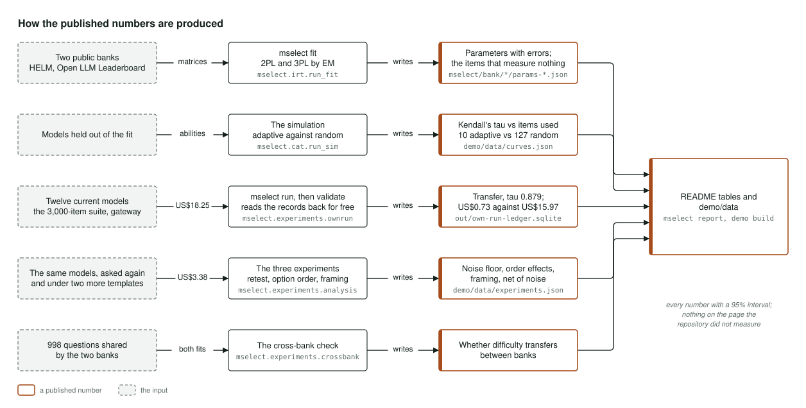

# Architecture

How the project is put together, in three pictures: the whole system, the adaptive test as a
loop, and how each published number is produced. For the reasoning behind the design, read
[PLAN.md](../PLAN.md). For the argument written for a practitioner, read
[writeup.md](writeup.md). The same three pictures are on the live demo at
[adaptive.peterparker.ca/architecture.html](https://adaptive.peterparker.ca/architecture.html).

## The system

The diagram reads left to right: the question bank, the test, and what gets published.

The bank is built from public results. HELM and the Open LLM Leaderboard publish how each model
did on each individual question, and those results are fetched, frozen and fingerprinted into
two independent banks. Each bank is fitted with item response theory, the statistics behind
standardised exams. That gives every question a difficulty and a measure of how sharply it
separates stronger models from weaker ones, each with a standard error. Diagnostics then name
the questions that measure nothing, with the evidence for each.

The test runs against real answers. Twelve current models were asked the frozen 3,000-question
suite through the portfolio's gateway, which capped the spend and recorded every call. The
adaptive test asks one question at a time and stops as soon as it knows enough. It runs against
those recorded answers, so it is tested on models the fit never saw. Three experiments on the
same models measure how much the answers change when you simply ask again, shuffle the options
or reword the prompt. The power calculation, how many questions you need to catch a given drop,
is the piece project 03 imports.

What gets published comes from the same stored files: the simulation of adaptive testing against
random sampling, the report that writes the README's tables and figures, and the page at
adaptive.peterparker.ca, which is five static files and a folder of JSON.

Where it lives: `mselect.data`, `mselect.irt`, `mselect.runner`, `mselect.cat`,
`mselect.experiments`, `mselect.power`, `mselect.handover`, `mselect.report` and `mselect.demo`.

## The adaptive test

This is what happens when you press Run the test on the demo.

The test starts from a neutral guess about the model's ability. It picks the question that would
tell it the most at that ability, keeping a balance across the source benchmarks, and asks it.
The answer comes from the recorded run, or from a live call through the gateway when one is
wired in. After each answer the test updates its estimate of the model's ability, along with how
uncertain that estimate still is.

It stops in one of two ways: when the estimate is precise enough, or when two models' ranges no
longer overlap and the ranking is settled. Otherwise it picks the next question and goes round
again.

Because the uncertainty is known at every step, you can also ask in advance how many questions a
decision will need. A budget too small to catch the drop you care about shows up before the
first paid call. The result is an ability with its interval, the questions used and the dollars
spent. Asking the same number of questions at random is the comparison, and at ten questions
random sampling usually has not settled the ranking.

Where it lives: `mselect.cat.select`, `mselect.cat.estimate`, `mselect.cat.stop` and
`mselect.runner`.

## How the published numbers are produced

Every number in the README comes from a stated input, through one command, into a stored file.
This is how each one is made.

The fit writes each question's parameters and the list of broken questions from the two public
banks. The simulation writes the curve of ranking accuracy against the number of questions
asked, adaptive against random, on models held out of the fit.

The results on real models come from one paid run: the 3,000-question suite put to twelve
current models through the gateway for US$18.25. Reading those records back costs nothing, and
that is where the transfer result and the cost per ranking decision come from. The three
experiments asked the same models again and added two prompt templates for US$3.38, so each
template is judged against the noise measured under that same template. A cross-bank check asks
whether a question's difficulty, calibrated on one panel of models, still means anything on the
other, across the 998 questions the two banks share.

Finally, one command writes every number in the README and another writes the demo's data, both
from those stored files, so nothing on the page can say anything the repository did not measure.
Every number carries a 95% interval.

Where it lives: `mselect.irt.run_fit`, `mselect.cat.run_sim`, `mselect.experiments.ownrun`,
`mselect.experiments.analysis`, `mselect.experiments.crossbank`, `mselect.report` and
`mselect.demo`.
